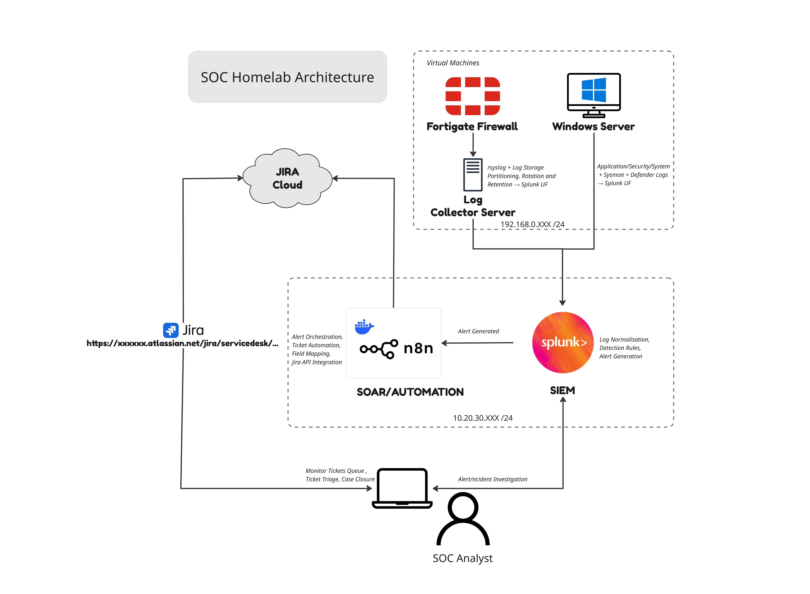

# Security Operations & Detection Engineering Lab

A practical SOC engineering homelab for learning how security monitoring,
logging, detection engineering, automation, and incident ticketing work together
as one operational system.

The project is built around an isolated lab environment using Splunk, FortiGate,
Windows endpoints, Sysmon, rsyslog, n8n, and Jira Service Management. The goal
is not to reproduce a full enterprise SOC, but to understand the relationships
between its tools and build detections from activity observed in the lab.

> **Project status:** actively developing. New integrations, detections, and
> investigation notes will be added as the lab progresses.

## Navigation

- [Architecture](#architecture)
- [Technology Stack](#technology-stack)
- [Project Scope](#project-scope)
- [Setup and Integration](#setup-and-integration)
- [Detection Engineering](#detection-engineering)
- [Test Scripts](#test-scripts)
- [Future Enhancements](#future-enhancements)
- [Limitations](#limitations)

## Architecture



The architecture represents the current lab design. IP addresses and subnets in
the diagram are examples from my own environment and must be replaced when the
lab is deployed on another network.

```text
FortiGate / Windows endpoints
              |
              v
       Log Collector (optional)
              |
              v
            Splunk
              |
              v
            n8n
              |
              v
       Jira Service Management
```

### How the components work together

1. **FortiGate** produces firewall and network security logs.
2. **Windows Server and Windows 10** produce Windows, PowerShell, Defender,
   Sysmon, and, optionally, IIS or SSH events.
3. **Log Collector** receives and stores FortiGate syslog, applies rotation, and
   forwards the stored logs through Splunk Universal Forwarder.
4. **Splunk Enterprise** receives, indexes, searches, normalizes, and detects
   activity from the collected data.
5. **n8n** receives selected Splunk alert results through a webhook and prepares
   the alert for automation.
6. **Jira Service Management** receives an issue from n8n for analyst tracking
   and investigation.
7. **The SOC analyst** investigates the alert, updates the ticket, and follows
   the configured workflow.

The Log Collector is optional. FortiGate can send logs directly to Splunk, and
that is enough for the SOC homelab to function. The collector is included for
learning about reliable syslog, dedicated storage, rotation, retention, and
forwarding architecture.

Similarly, n8n and Jira are optional extensions. Splunk can detect and display
alerts without them. They are included to demonstrate SOAR-style automation and
case management.

## Technology Stack

| Area | Technology | Purpose |
|---|---|---|
| Virtualization | VMware | Hosts the isolated lab virtual machines |
| Firewall | FortiGate VM | Network control and firewall telemetry |
| Endpoints | Windows Server, Windows 10 | Security and application event sources |
| Endpoint telemetry | Sysmon, PowerShell logging, Windows Defender | Detailed endpoint activity |
| Web telemetry | IIS | Web access and application traffic logs |
| Log collection | Debian, rsyslog | Optional reliable syslog collection and storage |
| SIEM | Splunk Enterprise | Indexing, search, normalization, alerting, and monitoring |
| Forwarding | Splunk Universal Forwarder | Sends endpoint and collector data to Splunk |
| Automation | n8n on Docker | Alert orchestration and integration workflows |
| Ticketing | Jira Service Management Cloud | Investigation tickets and workflow tracking |
| Detection formats | SPL and Sigma | Splunk-native and portable detection logic |
| Normalization | Custom FortiGate-to-OCSF TA | Search-time field normalization |

## Project Scope

This project focuses on understanding the overall SOC operating model:

- How telemetry is generated and transported
- How logs are indexed and searched
- How detections are written and enriched
- How alerts are routed to automation
- How investigations are tracked as tickets
- How a detection is tested against observed activity

The repository focuses on the configuration and operational reasoning behind
the lab. It does not attempt to document every installation detail for Docker,
VMware, operating systems, VM networking, or every vendor prerequisite. Those
steps depend heavily on the host environment and are intentionally kept brief.

## Setup and Integration

The setup documentation is grouped by component under
[`setup-&-integration`](setup-%26-integration/).

### Firewall

[FortiGate setup and network configuration](setup-%26-integration/firewall/fortigate-vm-setup.md)
 covers VM image acquisition, VMware import, interfaces, DNS, NTP, and baseline
network configuration.

### Endpoints

[Windows endpoint telemetry](setup-%26-integration/endpoints/windows-endpoint-telemetry.md)
 covers Universal Forwarder installation, receiving indexer configuration,
PowerShell logging, and Sysmon.

- [Windows Server setup](setup-%26-integration/endpoints/winserver/windows-server-setup.md)
- [Windows 10 setup](setup-%26-integration/endpoints/win10pc/windows-10-setup.md)
- Optional IIS and OpenSSH configuration are documented with the Windows Server
  notes.

### Log Collector

[Log Collector setup](setup-%26-integration/log-collector/log-collector-setup.md)
 covers Debian, rsyslog, dedicated storage, persistent mounting, and log
rotation.

- [FortiGate to Log Collector](setup-%26-integration/log-collector/integration/fortigate-to-log-collector.md)
- [Log Collector to Splunk](setup-%26-integration/log-collector/integration/log-collector-to-splunk.md)

The collector is an optional learning component, not a hard requirement for the
main SOC workflow.

### Splunk Enterprise

[Splunk Enterprise setup](setup-%26-integration/splunk/splunk-enterprise-setup.md)
 covers the trial installation, custom lab IP binding, first web login, and
receiving port `9997`.

### n8n

[n8n setup](setup-%26-integration/n8n/n8n-setup.md) covers the Docker Compose
container and basic verification.

- [n8n workflow](setup-%26-integration/n8n/n8n-workflow.md)
- [Splunk to n8n alert integration](setup-%26-integration/n8n/integration/splunk-to-n8n-alert.md)
- [Jira Cloud integration in n8n](setup-%26-integration/n8n/integration/jira-cloud-integration.md)

### Jira Service Management

[Jira Cloud setup](setup-%26-integration/jira/jira-setup.md) covers account
creation, JSM space creation, and the IT service management template.

- [Jira configuration](setup-%26-integration/jira/jira-configuration.md)
- Request types, ticket fields, queues, and the SOC ticket workflow

Jira and n8n are optional extensions for automation and case management.

## Detection Engineering

The detection engineering work is organized under
[`detection-engineering`](detection-engineering/).

### Splunk fundamentals

[Splunk fundamentals](detection-engineering/basic-splunk-conf-understanding/splunk-fundamentals.md)
 introduces indexes, lookups, lookup definitions, search macros, Monitoring
Console, and basic alert creation.

### Custom Splunk TAs

[Custom TA structure](detection-engineering/custom-splunkTA/README.md) explains
Splunk app layout, `default/`, `local/`, `metadata/`, knowledge-object scope,
installation, restart, and `btool` validation.

- [TA-fortigate-ocsf](detection-engineering/custom-splunkTA/TA-fortigate-ocsf/README.md)
  performs on-read FortiGate-to-OCSF-style field normalization while retaining
  the original `_raw` event.
- [SOC_Detections](detection-engineering/custom-splunkTA/SOC_Detections/README.md)
  collects the project's saved searches, macros, lookup definitions, indexes,
  metadata, and alert configuration.

### Homemade rules

[Homemade rules](detection-engineering/homemade-rules/README.md) contains
hand-built detections created from investigation activity. Each current rule
has:

- A Sigma rule
- A converted Splunk SPL version
- Detection metadata
- A path toward saved-alert validation and deployment

The first two rules came from the BlueHammer POC investigation, where activity
was executed in the isolated lab, endpoint logs were investigated, and the
observed behavior was converted into detection logic.

## Test Scripts

The [`scripts`](scripts/) directory contains small utilities for generating
controlled endpoint activity and validating telemetry.

The current IIS traffic script sends repeated requests to normal pages,
administrative paths, missing pages, and common probe paths to produce IIS logs.
Future scripts can generate SSH activity or other service events for detection
testing.

## Cost and Access Model

The project is designed to be built with free or low-cost access:

- Splunk Enterprise uses a trial or available free lab license.
- Jira Cloud uses a free account or available free plan.
- n8n runs locally in Docker.
- FortiGate VM availability depends on the account, image, and lab license.
- Windows and VMware depend on the licenses and resources available to the lab
  host.
- Some services require account creation even when no payment is required.

License availability and trial terms can change. Check each vendor's current
terms before deployment.

## Future Enhancements

### Detection engineering

- Investigate additional malware behaviors and CVEs in the isolated lab.
- Create new detections from observed endpoint, firewall, and web activity.
- Improve Sigma coverage and Splunk conversion quality.
- Add detection tests, expected results, and false-positive analysis.
- Expand normalization and metadata coverage.

### Automation and AI-assisted operations

- Improve n8n alert routing and enrichment.
- Build automation for common, low-risk, or clearly classified alerts.
- Explore an AI-assisted SOC analyst workflow for triage and routine decisions.
- Use AI to assist with SPL generation, search refinement, and log analysis while
  keeping human review for consequential actions.
- Extend n8n and Jira integration for investigation updates and closure steps.

### Threat intelligence

- Add threat-intelligence enrichment to alert workflows.
- Evaluate OpenCTI integration for indicators, relationships, and intelligence
  context.
- Connect intelligence data to Splunk searches, n8n workflows, and Jira cases.

## Limitations

This is a personal homelab and cannot reproduce the scale, resilience, support,
or commercial capabilities of a production enterprise environment.

- Free plans and trials may have feature, retention, or usage limits.
- Vendor interfaces and licensing models can change.
- The lab uses personal hardware: two laptops with a combined 32 GB of RAM.
- VM count and workload are limited by available memory, CPU, and storage.
- Network addressing is specific to the author's environment.
- Some enterprise controls, clustering, high availability, production TLS, and
  large-scale data retention are outside the current scope.
- The repository does not fully document VMware installation, Docker
  installation, operating-system installation, or every VM network setup.
- All testing is intended for isolated lab systems and controlled data sources.

## Project Direction

The lab will continue to evolve as new investigations, detections,
integrations, and operational lessons are added. The main objective is to
build practical understanding of SOC tools and operations while developing and
validating detection engineering skills in an isolated environment.
