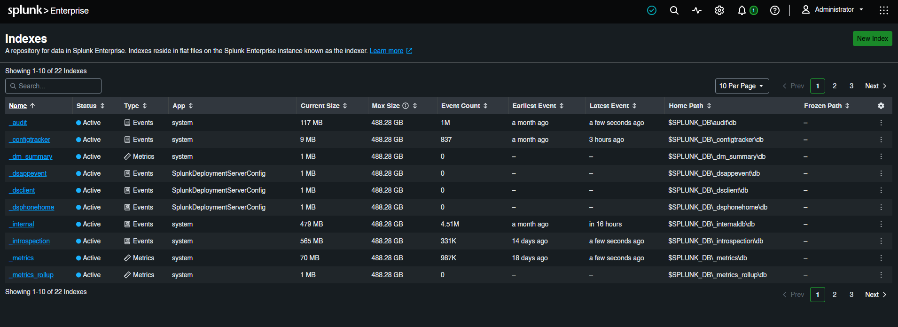
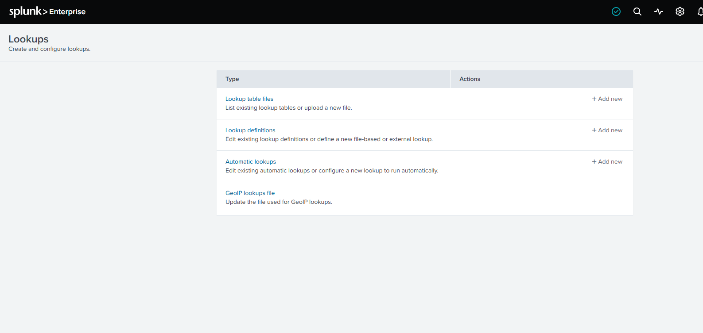
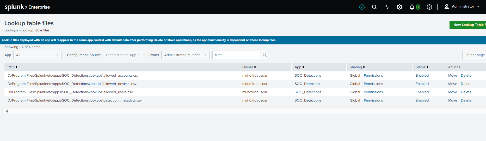
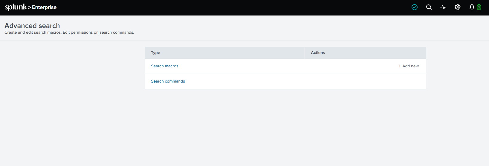
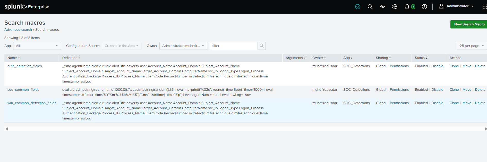
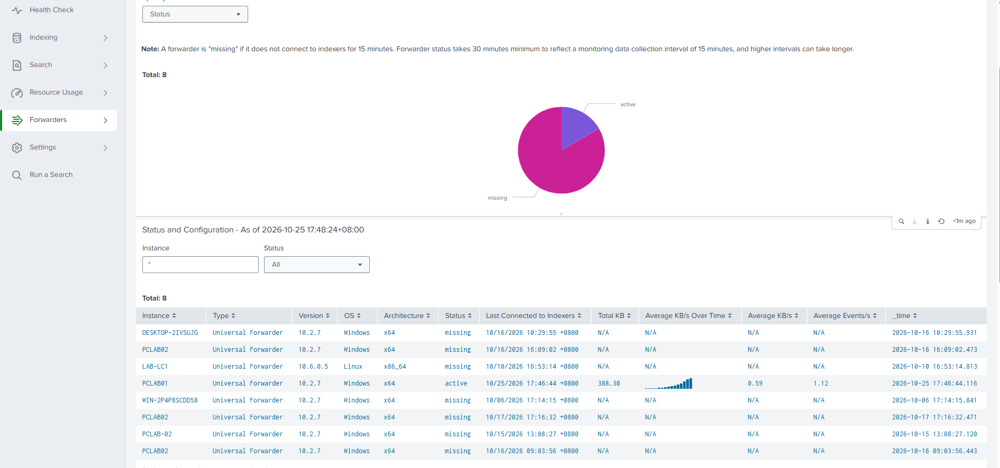
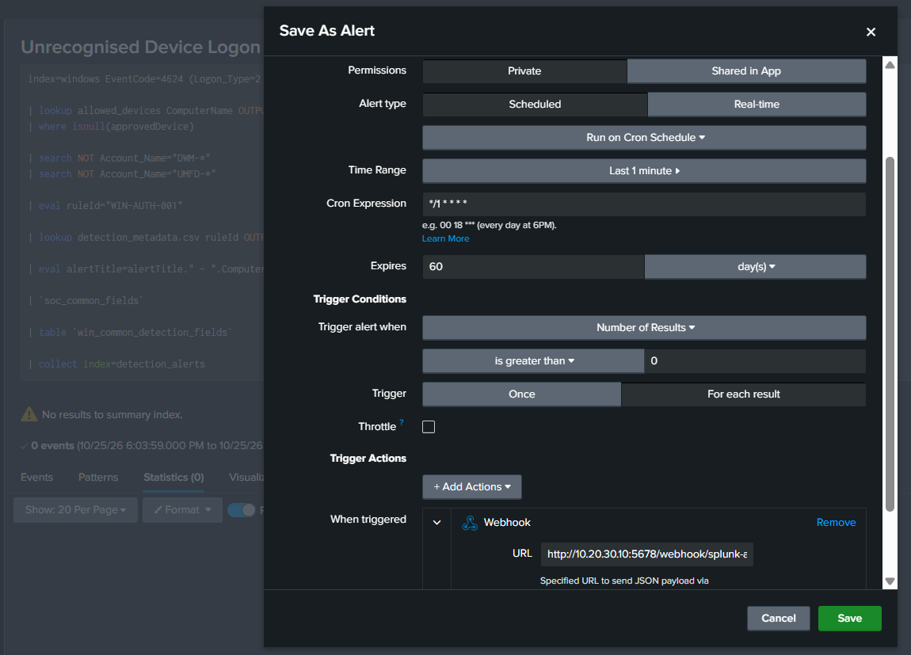

# Splunk Fundamentals for Detection Engineering

This note covers the Splunk objects used before building custom detections:
indexes, lookups, search macros, Monitoring Console, and saved alerts.

## 1. Indexes

An index is a logical storage area for events. It helps separate data by use
case and makes searches, retention, and permissions easier to manage.

Examples from this lab:

```text
index=windows
index=web
index=firewall
index=detection_alerts
```

The index must match the value configured by the data input. For example, the
Windows endpoint `inputs.conf` sends Windows events to `index=windows`, while
IIS logs use `index=web`.



Useful checks:

```spl
| tstats count where index=* by index
index=windows | stats count by sourcetype
index=web | stats count by host source sourcetype
```

## 2. Lookups

Lookups enrich events with fixed or maintained reference data. They are useful
when a detection needs information that is not present in the raw event.

Examples:

- Approved usernames
- Approved devices
- Approved service accounts
- Detection metadata
- Country or location mappings

A lookup has two related parts:

1. **Lookup table file**: the CSV or other source data.
2. **Lookup definition**: the Splunk object that maps the lookup name to the
   file and defines how searches use it.

The lookup files in the custom `SOC_Detections` app include files such as
`allowed_users.csv`, `allowed_devices.csv`, `allowed_accounts.csv`, and
`detection_metadata.csv`.





Example lookup search:

```spl
index=windows EventCode=4624
| lookup allowed_devices ComputerName OUTPUT approvedDevice
| where isnull(approvedDevice)
```

A detection metadata lookup can add a stable rule ID, title, severity, and MITRE
mapping to an alert result:

```spl
| lookup detection_metadata ruleId OUTPUT alertTitle severity mitreTactic mitreTechniqueId mitreTechniqueName
```

## 3. Search macros

A search macro is a reusable SPL fragment. It reduces repeated syntax and keeps
alerts shorter and more consistent.

Create and manage macros under:

```text
Settings > Advanced Search > Search macros
```



This lab uses macros such as:

- `soc_common_fields`
- `win_common_detection_fields`
- `auth_detection_fields`

Typical uses include:

- Standard alert fields
- Common Windows fields
- Common authentication fields
- Normalized timestamps
- Stable event IDs
- Raw event preservation



Example macro usage:

```spl
| `soc_common_fields`
| table `win_common_detection_fields`
```

Keep macros focused. A macro should remove meaningful repetition without hiding
the detection logic from someone reviewing the alert.

## 4. Monitoring Console

Monitoring Console provides operational visibility into the Splunk platform. It
can show forwarder status, indexing activity, search performance, resource
usage, and ingestion health.

For endpoint onboarding, the Forwarders view is useful for checking:

- Which Universal Forwarders are connected
- Whether a forwarder is active or missing
- Forwarder version and operating system
- Last connection time
- Event and data throughput



A forwarder marked `missing` may be powered off, disconnected, misconfigured,
or outside the Monitoring Console collection interval. Confirm the forwarder
service and network connection before treating it as a data-source failure.

## 5. Create a basic alert

A basic alert starts as an SPL search that identifies a condition. The search
can then be saved as a scheduled or real-time alert.

Example detection pattern:

```spl
index=windows EventCode=4624 Logon_Type=2
| lookup allowed_devices ComputerName OUTPUT approvedDevice
| where isnull(approvedDevice)
| search NOT Account_Name="DWM-*"
| search NOT Account_Name="UMFD-*"
| eval ruleId="WIN-AUTH-001"
| lookup detection_metadata ruleId OUTPUT alertTitle severity mitreTactic mitreTechniqueId mitreTechniqueName
| `soc_common_fields`
| table `win_common_detection_fields`
```

Before saving the alert:

1. Confirm that the SPL returns the expected events.
2. Check the time range.
3. Decide whether the alert should be scheduled or real-time.
4. Choose the trigger condition.
5. Set a throttle if repeated events should be grouped.
6. Add the required trigger actions.



Common alert settings include:

| Setting | Purpose |
|---|---|
| Permissions | Keep the alert private or share it in the app |
| Alert type | Scheduled or real-time execution |
| Time range | Search window used by a scheduled alert |
| Cron expression | Exact schedule for the search |
| Expiration | How long the alert remains active |
| Trigger condition | Result count or custom condition |
| Trigger mode | Once per search or once per result |
| Throttle | Suppress duplicate alerts for a period |
| Trigger actions | Webhook, email, add to triggered alerts, or other actions |

For the lab integration, the webhook action sends the alert result to n8n.
The alert can also be added to Splunk's triggered alerts for local visibility.

## 6. Detection development sequence

Use this order when creating a detection:

1. Confirm the source data and index.
2. Write and test the raw SPL.
3. Add lookup enrichment.
4. Replace repeated SPL with a macro where appropriate.
5. Add stable metadata such as rule ID, severity, and MITRE mapping.
6. Validate the returned fields.
7. Save the search as an alert.
8. Configure trigger actions.
9. Test the alert and downstream webhook.
10. Document the final SPL and expected data source.

The next detection-engineering sections cover the custom Splunk TA, hand-built
SPL detections, and Sigma rules converted into Splunk searches.
