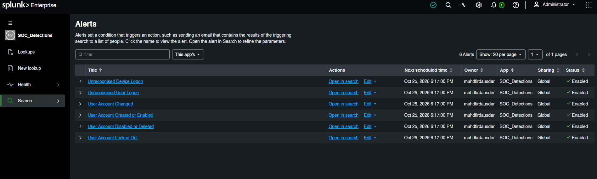

# SOC_Detections

`SOC_Detections` is the custom Splunk app used to collect and deploy the
project's Splunk detection content.

Its purpose is to keep detection rules and their supporting knowledge objects
in one app:

- Saved searches and alerts
- Reusable search macros
- Lookup definitions and lookup tables
- Lookup transforms
- Detection result indexes
- App and knowledge-object metadata

This app contains detection logic. The separate `TA-fortigate-ocsf` app handles
FortiGate field normalization before detections search the events.

## App structure

```text
SOC_Detections/
├── README.md
├── local/
│   ├── app.conf
│   ├── indexes.conf
│   ├── macros.conf
│   ├── savedsearches.conf
│   └── transforms.conf
├── lookups/
│   ├── allowed_accounts.csv
│   ├── allowed_devices.csv
│   ├── allowed_users.csv
│   ├── detection_metadata.csv
│   └── ...
└── metadata/
    └── local.meta
```

## Configuration files

### `local/savedsearches.conf`

Contains saved SPL searches, including the scheduled alerts created for this
project. A saved search stores more than the SPL itself, including:

- Search query
- Schedule and cron expression
- Earliest and latest time range
- Trigger condition
- Alert severity and expiry
- Suppression or throttling
- Webhook and triggered-alert actions
- App and sharing settings

The current app contains alerts for:

- Unrecognised Device Logon
- Unrecognised User Logon
- User Account Changed
- User Account Created or Enabled
- User Account Disabled or Deleted
- User Account Locked Out



A typical detection follows this pattern:

```spl
index=windows EventCode=4624
| lookup allowed_devices ComputerName OUTPUT ComputerName AS approvedDevice
| where isnull(approvedDevice)
| eval ruleId="WIN-AUTH-001"
| lookup detection_metadata.csv ruleId OUTPUT alertTitle severity mitreTactic mitreTechniqueId mitreTechniqueName
| `soc_common_fields`
| table `win_common_detection_fields`
| collect index=detection_alerts
```

The alerts are scheduled every minute with a one-minute search window in the
current lab configuration. The webhook action sends selected alert results to
the n8n automation endpoint.

### `local/macros.conf`

Contains reusable SPL fragments.

Current examples:

- `soc_common_fields`: creates common fields such as `alertId`, `timestamp`,
  `agentName`, and `rawLog`.
- `auth_detection_fields`: standard output fields for authentication detections.
- `win_common_detection_fields`: standard output fields for Windows detections.

Macros keep alert SPL shorter and ensure that detections return a consistent
field set.

Example:

```spl
| `soc_common_fields`
| table `win_common_detection_fields`
```

### `local/transforms.conf`

Defines lookup behavior. It connects a lookup name used in SPL to a lookup
file and controls how Splunk reads that table.

Example:

```ini
[allowed_devices]
filename = allowed_devices.csv
```

The lookup file contains the data. The transform definition tells Splunk how
to use that file in a search.

### `local/indexes.conf`

Defines indexes used by the detection app and its alert results. It controls
index storage paths and maximum total data size.

Current indexes include:

- `windows`: Windows endpoint events
- `web`: IIS web events
- `firewall`: FortiGate events
- `detection_alerts`: normalized alert results generated by detections
- `alerts`: supporting alert storage

`indexes.conf` defines index behavior; it does not collect events by itself.
Inputs and forwarders send events into the index.

### `local/app.conf`

Defines basic app properties such as:

- App label
- Whether the app is visible in Splunk Web
- Supported UI themes
- Update-check behavior

### `metadata/local.meta`

Controls knowledge-object sharing and ownership. In this app, alert, macro,
lookup, transform, and index objects are mostly exported globally so they can
be used by other apps and searches.

For example:

```ini
[savedsearches/Unrecognised%20Device%20Logon]
access = read : [ * ], write : [ admin, splunk-system-role ]
export = system
```

`export = system` makes the object available across apps. Use `export = app`
when an object should remain limited to `SOC_Detections`.

The metadata controls Splunk knowledge-object visibility, not Windows NTFS file
permissions. The Splunk service account still needs filesystem access to the
app directory.

## Lookup content

The lookup files provide fixed reference data and detection metadata:

- `allowed_users.csv`: approved users
- `allowed_devices.csv`: approved devices
- `allowed_accounts.csv`: approved accounts
- `detection_metadata.csv`: rule ID, title, severity, and MITRE metadata
- Geographic CSV/KMZ files: geographic enrichment data

Example:

```spl
| lookup detection_metadata.csv ruleId OUTPUT alertTitle severity mitreTactic mitreTechniqueId mitreTechniqueName
```

## Installation

Copy the complete app directory into the Splunk Enterprise apps directory:

```text
<SPLUNK_HOME>\etc\apps\SOC_Detections
```

For the lab:

```text
D:\Program Files\Splunk\etc\apps\SOC_Detections
```

Restart Splunk after installing or changing the app:

```bat
cd /d "D:\Program Files\Splunk\bin"
splunk.exe restart
```

## Validation

Confirm that Splunk loaded the saved searches:

```bat
splunk.exe btool savedsearches list --debug
```

Confirm macros:

```bat
splunk.exe btool macros list --debug
```

Confirm lookup definitions:

```bat
splunk.exe btool transforms list --debug
```

Confirm index definitions:

```bat
splunk.exe btool indexes list --debug
```

Then validate a detection from Splunk Search:

```spl
index=detection_alerts
| stats count by ruleId alertTitle severity
```

## Related documentation

- [Splunk fundamentals](../../basic-splunk-conf-understanding/splunk-fundamentals.md)
- [Custom TA structure](../README.md)
- [TA-fortigate-ocsf](../TA-fortigate-ocsf/README.md)
