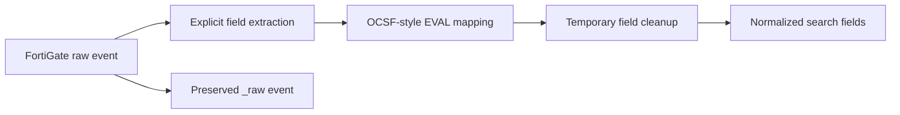

# TA-fortigate-ocsf

[Custom TA structure and installation guide](../README.md)

## Purpose

`TA-fortigate-ocsf` is a custom Splunk add-on for on-read normalization of
FortiGate firewall events into OCSF-style field names.

It is a log normalization component within the detection engineering project,
not a complete OCSF implementation or the main focus of the project.

The add-on applies to events with the FortiGate sourcetype:

```text
[fortigate]
```

## Normalization model



The add-on uses `props.conf` to:

1. Disable automatic key/value extraction with `KV_MODE = none`.
2. Extract selected FortiGate fields into temporary fields.
3. Assign those values to OCSF-style dotted fields with `EVAL-*` settings.
4. Place vendor-specific or currently unmapped fields under `unmapped.*`.
5. Remove the temporary fields after the normalized fields are created.

This is search-time, or on-read, normalization. The indexed event is not
rewritten. The original FortiGate event remains available in `_raw`.

Because automatic extraction is disabled, original FortiGate keys such as
`srcip` and `dstip` should not be assumed to remain as standalone search fields.
Use the normalized fields for searches and `_raw` when the original vendor
representation is required.

## Example mappings

| FortiGate field | OCSF-style field | Type |
|---|---|---|
| `devid` | `device.uid` | Mapped |
| `devname` | `device.name` | Mapped |
| `srcip` | `src_endpoint.ip` | Mapped |
| `dstip` | `dst_endpoint.ip` | Mapped |
| `srcport` | `src_endpoint.port` | Mapped |
| `dstport` | `dst_endpoint.port` | Mapped |
| `policyid` | `firewall_rule.uid_numeric` | Mapped |
| `policyname` | `firewall_rule.name` | Mapped |
| `poluuid` | `firewall_rule.uid` | Mapped |
| `proto` | `connection_info.protocol_num` | Mapped |
| `sentbyte` | `traffic.bytes_out` | Mapped |
| `rcvdbyte` | `traffic.bytes_in` | Mapped |
| `sentpkt` | `traffic.packets_out` | Mapped |
| `rcvdpkt` | `traffic.packets_in` | Mapped |
| `service` | `service.name` | Mapped |
| `sessionid` | `connection_uid` | Mapped |
| `user` | `actor.user.name` | Mapped |
| `appcat` | `unmapped.appcat` | Unmapped vendor field |
| `srcintf` | `unmapped.srcintf` | Unmapped vendor field |
| `dstintf` | `unmapped.dstintf` | Unmapped vendor field |
| `logid` | `unmapped.logid` | Unmapped vendor field |
| `vd` | `unmapped.vd` | Unmapped vendor field |

## Add-on structure

```text
TA-fortigate-ocsf/
├── README.md
├── local/
│   └── props.conf
└── metadata/
    └── local.meta
```

### `local/props.conf`

Contains the FortiGate extraction and OCSF field mappings. The current
implementation uses temporary fields named `tmp_0001` through `tmp_0059` to
avoid directly extracting into the final dotted field names.

### `metadata/local.meta`

```ini
[props]
export = system
```

This makes the add-on's `props.conf` knowledge objects available globally.

## Installation

Copy the add-on directory into the Splunk Enterprise apps directory:

```text
<SPLUNK_HOME>\etc\apps\TA-fortigate-ocsf
```

For the lab installation, `<SPLUNK_HOME>` is:

```text
D:\Program Files\Splunk
```

Restart Splunk after installing or changing the add-on:

```bat
cd /d "D:\Program Files\Splunk\bin"
splunk.exe restart
```

## Validation

Confirm that FortiGate events are present before validating normalization:

```spl
index=firewall sourcetype=fortigate
| stats count
```

Inspect normalized fields:

```spl
index=firewall sourcetype=fortigate
| table _time device.uid device.name src_endpoint.ip dst_endpoint.ip src_endpoint.port dst_endpoint.port service.name connection_uid firewall_rule.uid firewall_rule.name traffic.bytes_in traffic.bytes_out actor.user.name severity
```

Inspect unmapped vendor fields:

```spl
index=firewall sourcetype=fortigate
| table _time unmapped.appcat unmapped.srcintf unmapped.dstintf unmapped.logid unmapped.vd
```

Confirm that the original event remains available:

```spl
index=firewall sourcetype=fortigate
| head 1
| table _raw
```

## Design references

- [OCSF schema](https://schema.ocsf.io/)
- [FortiOS log message fields](https://docs.fortinet.com/document/fortigate/8.0.0/fortios-log-message-reference/357866/log-message-fields)
- [props.conf](local/props.conf)
- [metadata/local.meta](metadata/local.meta)
