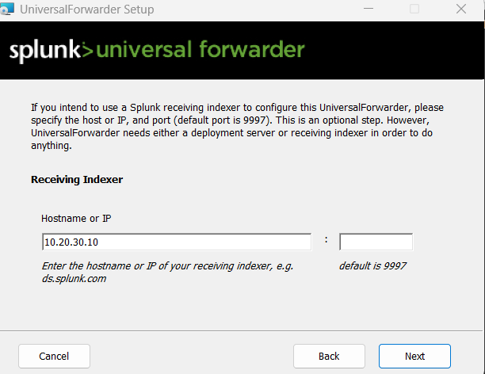
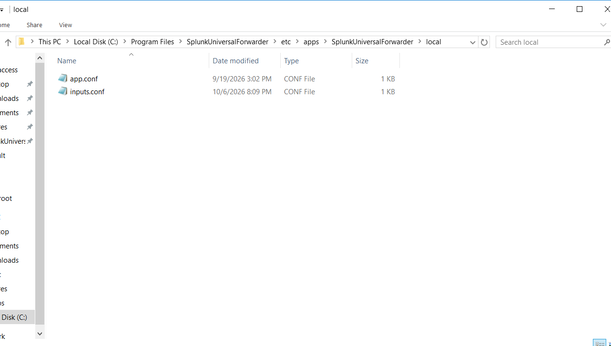
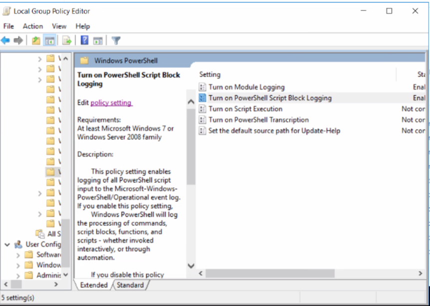

# Windows Endpoint Telemetry

This baseline applies to both the Windows Server and Windows 10 endpoints.
The host-specific `inputs.conf` files add the differences for each endpoint.

## 1. Install Splunk Universal Forwarder

1. Download the Windows Universal Forwarder installer from the [Splunk Universal Forwarder download page](https://www.splunk.com/en_us/download/universal-forwarder.html).
2. Run the `.msi` installer as Administrator.
3. Accept the license agreement.
4. Create or enter the local Splunk administrator credentials.
5. When asked for the receiving indexer, enter the Splunk Enterprise address:

   ```text
   Hostname or IP: 10.20.30.10
   Port: 9997
   ```

The receiving indexer must match the Splunk server and receiving configuration.
Port `9997` is the default Splunk-to-forwarder receiving port.



## 2. Add the endpoint inputs configuration

Place the host-specific file in the Universal Forwarder app `local` directory:

```text
C:\Program Files\SplunkUniversalForwarder\etc\apps\SplunkUniversalForwarder\local\inputs.conf
```



Use:

- [Windows Server inputs](winserver/inputs.conf)
- [Windows 10 inputs](win10pc/inputs.conf)

Restart the forwarder after changing `inputs.conf`:

```powershell
Restart-Service SplunkForwarder
```

Verify the service and receiving connection:

```powershell
Get-Service SplunkForwarder
Test-NetConnection 10.20.30.10 -Port 9997
& "C:\Program Files\SplunkUniversalForwarder\bin\splunk.exe" list forward-server
```

## 3. Enable PowerShell logging

Open the Local Group Policy Editor as Administrator:

```text
gpedit.msc
```

Go to:

```text
Computer Configuration
  > Administrative Templates
    > Windows Components
      > Windows PowerShell
```

### Enable Module Logging

1. Open **Turn on Module Logging**.
2. Select **Enabled**.
3. Under **Options**, select **Show**.
4. Add `*` to log all PowerShell modules.
5. Apply the policy.

### Enable Script Block Logging

1. Open **Turn on PowerShell Script Block Logging**.
2. Select **Enabled**.
3. Apply the policy.



Apply the updated policy:

```powershell
gpupdate /force
```

Verify PowerShell operational events:

```powershell
Get-WinEvent -LogName "Microsoft-Windows-PowerShell/Operational" -MaxEvents 10
```

## 4. Install and initialize Sysmon

The repository contains the Sysmon binaries and configuration under
[Sysmon](Sysmon/). Copy that directory to the endpoint:

```text
C:\Sysmon
```

Open **Command Prompt as Administrator** and run:

```bat
cd /d C:\Sysmon
Sysmon64.exe -accepteula -i sysmonconfig-export.xml
```

Verify the installation:

```bat
Sysmon64.exe -c
```

To apply an updated configuration later:

```bat
Sysmon64.exe -c sysmonconfig-export.xml
```

Sysmon events are collected by the following Universal Forwarder input:

```text
[WinEventLog://Microsoft-Windows-Sysmon/Operational]
disabled = 0
index = windows
sourcetype = sysmon
```

## 5. Common event sources

Both host configurations collect:

- Application event log
- Security event log
- System event log
- PowerShell operational events
- Windows Defender operational events
- Sysmon operational events

The Windows Server configuration additionally collects IIS logs. See the
[Windows Server setup](winserver/windows-server-setup.md).
