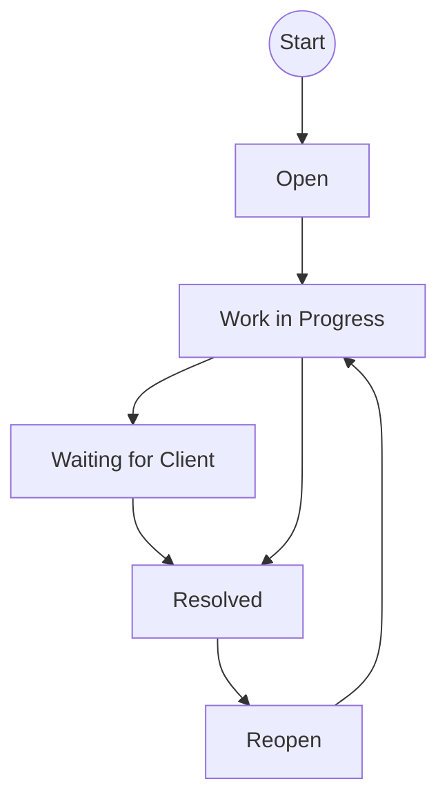
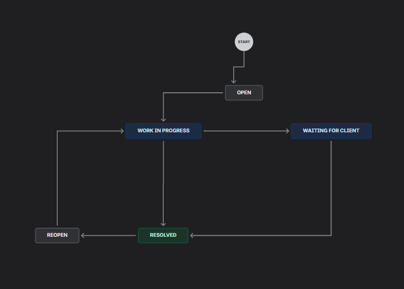
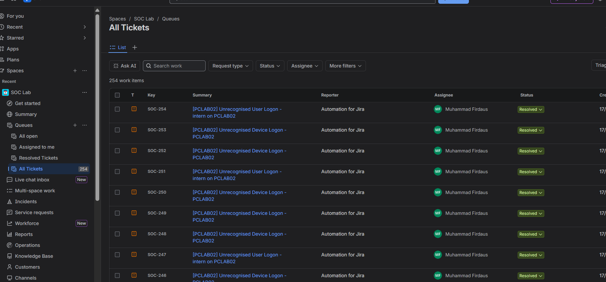

# Jira Configuration

Jira configuration is project-specific. The following is a practical baseline
for a SOC ticketing workflow rather than a complete Jira administration guide.

## 1. Create request types

Open the `SOC Lab` space settings and create request types that represent the
work entering the service desk. Examples:

- Security Alert
- Suspicious User Logon
- Suspicious Device Logon
- Malware or Endpoint Alert
- Phishing Investigation

A request type controls the form shown to a requester and maps the request to
a Jira issue type. Start with one or two request types until the ticket flow is
working, then add more specific types.

## 2. Configure ticket fields

Configure the fields that should appear on the request form and the ticket
view. A useful SOC baseline is:

| Field | Purpose |
|---|---|
| Summary | Short alert title and affected host |
| Description | Investigation details and full event context |
| Priority | Operational urgency |
| Severity | Detection severity |
| Alert ID | Link to the originating Splunk alert |
| Affected user | User involved in the event |
| Affected host | Endpoint or server involved |
| Source IP | Network source involved in the event |
| MITRE tactic | Detection classification |
| MITRE technique | Detection classification |
| Full log | Original event or normalized log |

Use the request type configuration to decide which fields are visible to the
requester. Use the issue layout or screen configuration to decide how agents
see and edit fields on the ticket.

The exact menu names can vary by Jira Cloud interface and plan. Look under
space or project settings for **Request types**, **Issue types**, **Screens**,
**Issue layout**, and **Fields**.

## 3. Create the SOC workflow

Create a new workflow from the space or Jira administration settings. Use
clear statuses and transitions that match the analyst process:

Recommended status meanings:

| Status | Meaning |
|---|---|
| Open | Alert has been received and requires triage |
| Work in Progress | Analyst is investigating the alert |
| Waiting for Client | Information or action is required from another party |
| Resolved | Investigation and required actions are complete |
| Reopen | A resolved ticket needs additional investigation |

Create the workflow, add the transitions, then associate it with the issue
type used by the SOC request types. Test every transition with a sample ticket
before connecting automation.

## 4. Configure queues

Create queues that help analysts work the incoming alerts. Useful starting
queues include:

- All open tickets
- Assigned to me
- Resolved tickets
- All tickets

The queue view should make the summary, priority, assignee, reporter, and status
visible for quick triage.

## 5. Connect automation after configuration

After request types, fields, workflow, and queues are working manually:

1. Create the Jira Cloud credential in n8n.
2. Map the n8n `summary`, `description`, and `priority` values to Jira.
3. Create a test issue from the n8n workflow.
4. Confirm the ticket enters the expected queue and status.
5. Confirm that the analyst can transition the ticket through the workflow.

See the [n8n Jira Cloud integration](../n8n/integration/jira-cloud-integration.md)
for the credential and Create Issue node configuration.
