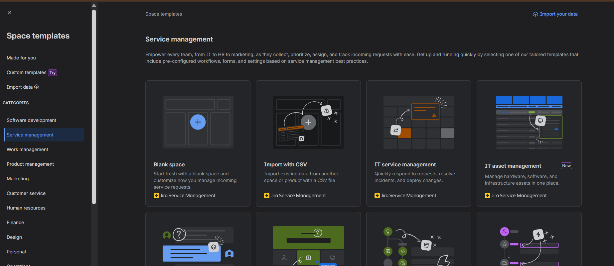
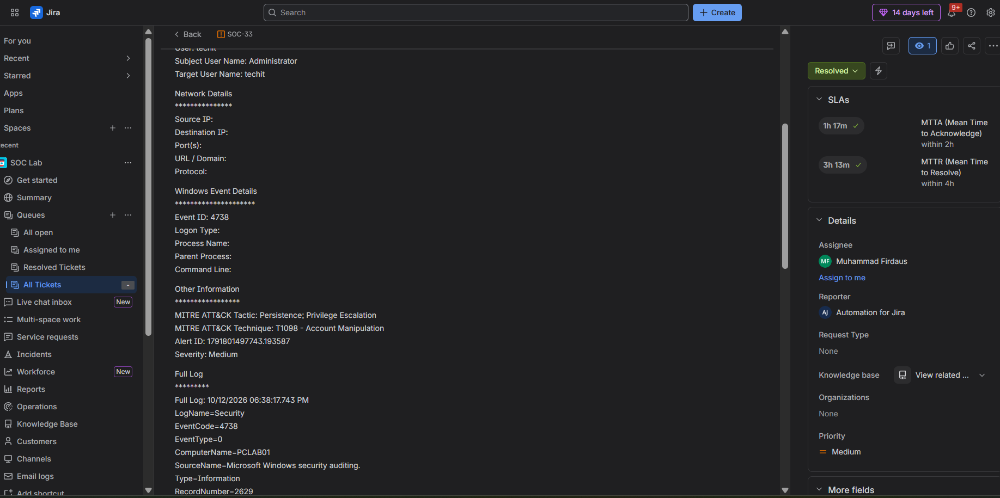

# Jira Cloud and JSM Setup

## 1. Create a Jira Cloud account

1. Open the [Jira Service Management website](https://www.atlassian.com/software/jira/service-management).
2. Start a free Jira Cloud account.
3. Complete the Atlassian account and site setup.
4. Sign in to Jira Cloud.

The exact onboarding screens can change. The account must have access to Jira
Service Management and permission to create a space and configure its work.

## 2. Skip the default onboarding template

Jira Cloud may open with a default onboarding space or template. Do not use
that space for this project. It can contain example data and settings that do
not represent the SOC workflow.

Use the space creation flow instead:

1. Open **Spaces** in the sidebar.
2. Select the **+** button.
3. Select **Create space**.
4. Choose **Jira Service Management**.
5. Choose the **IT service management** template.
6. Continue through the setup prompts.
7. Name the space `SOC Lab`.

## 3. Initial space setup

Use the first setup pass to confirm that:

- The `SOC Lab` space opens successfully.
- Jira Service Management is enabled.
- The project has queues and issue management available.
- An administrator or agent account can create and update tickets.
- The space URL and project key are recorded for n8n integration.

The template provides a starting point only. Request types, fields, queues, and
workflows should be adjusted to match the SOC process.

## 4. Confirm the ticket view

After the space is created, open the ticket queue and confirm that automated
SOC tickets display the required investigation context, including severity,
alert details, affected users or hosts, and the original event information.

Continue with [Jira Configuration](jira-configuration.md).
