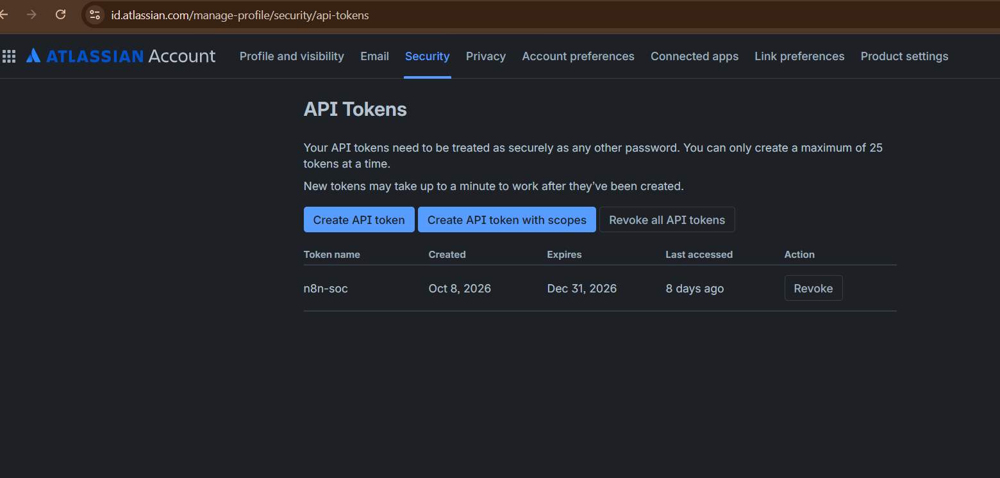

# Jira Cloud Integration

## Prerequisites

Create or access a Jira Cloud account before configuring the n8n Jira node.
The account must have access to the Jira Cloud site and permission to create
issues in the target project.

The workflow uses:

```text
Project: SOC Lab
Issue type: SOC Ticket
```

## Create a Jira API token

1. Sign in to the Atlassian account used by Jira Cloud.
2. Open the Atlassian API token page:
   [id.atlassian.com/manage-profile/security/api-tokens](https://id.atlassian.com/manage-profile/security/api-tokens)
3. Select **Create API token**.
4. Give the token a descriptive name, such as `n8n-soc`.
5. Set an expiry according to the lab requirements.
6. Copy the token when it is displayed.

The token is only displayed at creation time. Store it in the n8n credential
form and do not place it in workflow JSON, screenshots, or GitHub files.



## Create the n8n Jira credential

In the Jira **Create an issue** node, select **Create new credential** for the
Jira Software Cloud account and enter:

| Field | Value |
|---|---|
| Email | Atlassian account email |
| API Token | Token created in Atlassian |
| Domain | Jira Cloud site URL, for example `https://example.atlassian.net` |

Save and test the credential. Do not use the Atlassian account password as the
API credential.

## Configure Create an issue

In the Jira node, set:

| Setting | Value |
|---|---|
| Resource | `Issue` |
| Operation | `Create` |
| Project | `SOC Lab` |
| Issue Type | `SOC Ticket` |
| Summary | `{{$json.summary}}` |
| Description | `{{$json.description}}` |

Map the normalized priority value from Edit Fields to Jira’s priority field.
The available priority values depend on the Jira project configuration.


## Validate the integration

1. Send a test alert through the n8n Webhook node.
2. Confirm that Edit Fields produces the expected issue fields.
3. Execute the Jira node.
4. Open the `SOC Lab` project in Jira Cloud.
5. Confirm that one `SOC Ticket` issue was created with the alert summary and
   description.
