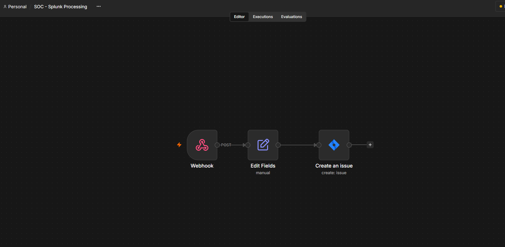
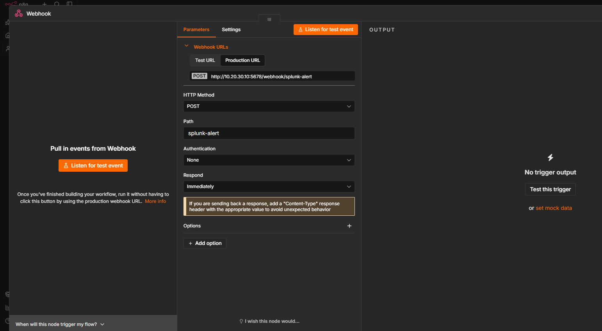
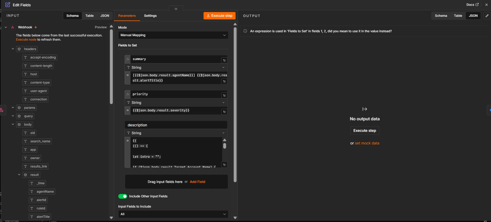
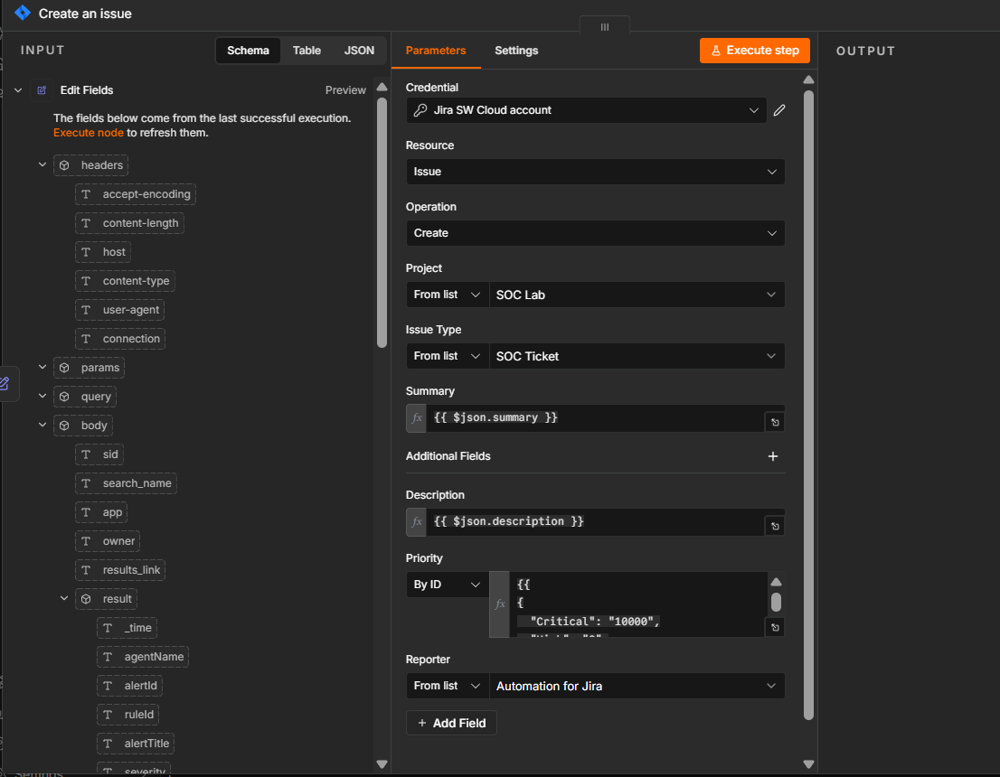

# n8n Workflow

## Workflow purpose

This workflow receives a Splunk security alert, formats the alert fields, and
creates a Jira Cloud issue for investigation.

```text
Webhook -> Edit Fields -> Create an issue
```



## 1. Add the Webhook node

Create a Webhook node with these values:

| Setting | Value |
|---|---|
| HTTP Method | `POST` |
| Path | `splunk-alert` |
| Authentication | `None` |
| Respond | `Immediately` |

The resulting production URL is:

```text
http://10.20.30.10:5678/webhook/splunk-alert
```

The test URL is used only while **Listen for test event** is active.



## 2. Add the Edit Fields node

Connect **Webhook** to **Edit Fields** and select **Manual Mapping**.
Create fields for the Jira issue:

| Field | Example expression | Purpose |
|---|---|---|
| `summary` | `{{$json.body.result.agentName}} - {{$json.body.result.alertTitle}}` | Jira issue title |
| `priority` | `{{$json.body.result.severity}}` | Alert severity |
| `description` | JavaScript expression using the alert fields | Investigation context |

Keep **Include Other Input Fields** enabled when the original alert data is
needed later in the workflow.



The exact expression path must match the payload received by the Webhook node.
The screenshots use `$json.body.result.*`; direct test payloads may instead use
`$json.body.*`.

## 3. Add the Jira Create Issue node

Connect **Edit Fields** to **Create an issue** and configure:

| Setting | Value |
|---|---|
| Resource | `Issue` |
| Operation | `Create` |
| Project | `SOC Lab` |
| Issue Type | `SOC Ticket` |
| Summary | `{{$json.summary}}` |
| Description | `{{$json.description}}` |
| Priority | Map the normalized priority value |

Select the Jira credential created during the Jira Cloud integration setup.



## 4. Test the workflow

1. Open the Webhook node.
2. Select **Listen for test event**.
3. Send a test POST request using
   [test-splunk-webhook.ps1](test-splunk-webhook.ps1).
4. Execute the Edit Fields node and inspect the mapped output.
5. Execute the Jira node and confirm that the issue is created.
6. Activate the workflow after the test path is working.

## Related integration notes

- [Splunk to n8n Alert Integration](integration/splunk-to-n8n-alert.md)
- [Jira Cloud Integration](integration/jira-cloud-integration.md)
