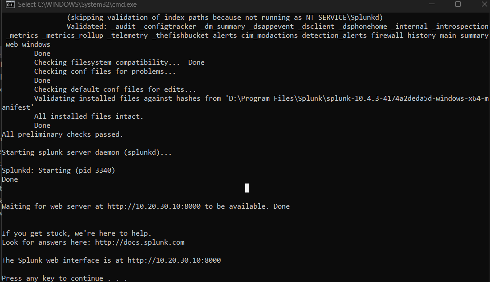
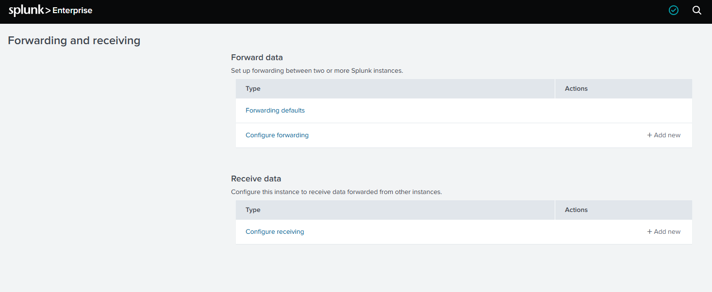

# Splunk Enterprise Setup

## Download the trial

1. Create or sign in to a Splunk account.
2. Open the [Splunk Enterprise download page](https://www.splunk.com/en_us/download/splunk-enterprise.html).
3. Start the Splunk Enterprise trial.
4. Download the Windows 64-bit installer.

The current Splunk Enterprise trial is available for 60 days. The installer
version used in this lab may differ from the current download version.

## Install Splunk Enterprise on Windows

1. Run the Windows installer as Administrator.
2. Accept the license agreement.
3. Choose the installation directory.
4. Create the initial Splunk administrator account.
5. Complete the installation.

The installation path used in this lab is (Path and IPs depend on your configuration):

```text
D:\Program Files\Splunk
```

## Lab-specific IP binding

Splunk does not use `10.20.30.10` as a universal default address. This lab
uses that address because the Splunk VM network and local Splunk configuration
were set to use it. Replace it with the address assigned to the Splunk VM in
another environment.

The Splunk configuration files are stored under:

```text
D:\Program Files\Splunk\etc\system\local\
```

The Web interface binding is configured in `web.conf`:

```ini
[settings]
httpport = 8000
server.socket_host = 10.20.30.10
```

Instance-level settings or the advertised Splunk address may also be stored in
`server.conf` in the same `local` directory. Keep those values consistent with
the VM network configuration when using a custom address.

After changing a local configuration file, restart Splunk:

```bat
cd /d "D:\Program Files\Splunk\bin"
splunk.exe restart
```

## Start Splunk Enterprise

Open **Command Prompt as Administrator**, then run:

```bat
cd /d "D:\Program Files\Splunk\bin"
splunk.exe start --accept-license
```

The startup process validates the installed files, starts `splunkd`, and starts
the Splunk Web service. The command output displays the web interface address.

Example:

```text
The Splunk web interface is at http://10.20.30.10:8000
```



## Open Splunk Web

Open the address shown in the command output in a browser:

```text
http://<splunk-ip>:8000
```

For this lab:

```text
http://10.20.30.10:8000
```

Sign in with the Splunk administrator account created during installation and
complete the initial setup prompts.

## Configure receiving port 9997

1. Open **Settings**.
2. Select **Forwarding and receiving**.
3. Under **Receive data**, select **Configure receiving**.
4. Select **Add new**.
5. Enter `9997` as the receiving port.
6. Save the configuration.



The receiving port is used by the Splunk Universal Forwarder on the log
collector when it forwards firewall logs to Splunk Enterprise.

## Verify the receiving port

On the Splunk server, run:

```bat
netstat -ano | findstr :9997
```

The port should be in a listening state after the receiving configuration is
saved.

## Related integration

Continue with [Log Collector to Splunk Integration](../log-collector/integration/log-collector-to-splunk.md).
